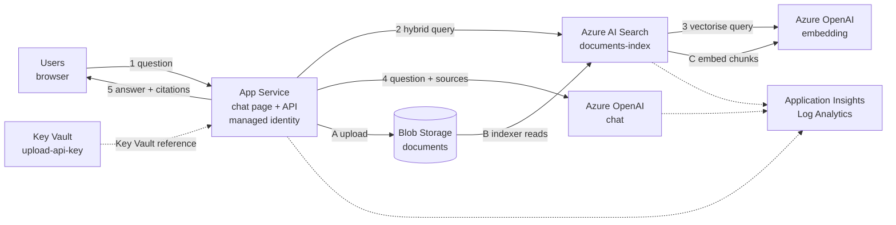

# Azure Deployment Architecture – AI Based Chatbot

*AI based chatbot platform* · Author: Vaibhav Chaudhary

This document covers:

- the components and why each was chosen
- how a question is answered and how documents are ingested
- security
- scaling and resilience

The diagram source is [`imgs/architecture.svg`](../imgs/architecture.svg) (hand-written SVG; edit it as text). A text version is at the end of this document.

## 1. Components

| Component | Azure resource (name pattern `<prefix>-<env>-<suffix>-*`) | Purpose | SKU parameters |
|---|---|---|---|
| Web app | App Service (Linux, Python 3.12), FastAPI on gunicorn/uvicorn | Serves the chat page and the API: `/api/chat`, `/api/document-names`, `/api/history`, `/api/documents`, `/healthz`. Creates the search index, data source, skillset and indexer on startup. | `appServicePlanSku`, `appServiceInstanceCount` |
| Language models | Azure OpenAI account with a `chat` and an `embedding` deployment | The chat model writes grounded answers. The embedding model vectorises document chunks (indexer) and questions (index vectorizer). | `openAiLocation`, `chat*`, `embedding*` |
| Retrieval | Azure AI Search, index `documents-index` | Hybrid search (keyword + vector) with optional semantic reranking. The indexer reads Blob Storage, splits documents into 2,000-character chunks with overlap, embeds them, and projects one search document per chunk. | `searchSku`, `searchReplicaCount`, `searchPartitionCount`, `semanticSearch` |
| Document store | Storage account (StorageV2), container `documents` | Source files. Blob soft delete lets the indexer remove deleted files from the index. Shared-key access is disabled. | `storageSku` |
| Secrets | Key Vault (RBAC mode) | The document upload key (`upload-api-key`), read by the web app through a Key Vault reference. | `keyVaultSku` |
| Monitoring | Log Analytics + workspace-based Application Insights | App telemetry (requests, dependencies, exceptions), plus diagnostic logs from App Service, AI Search and Azure OpenAI. | `logAnalyticsRetentionDays`, `logAnalyticsDailyQuotaGb` |

### Why these choices

- **App Service (not Container Apps or Functions)** matches the Call-Center-Analysis solution: one always-on web app, remote build from a zip or Git, health check, and managed identity, with no container registry to run.
- **AI Search integrated vectorization (indexer + skillset)** instead of a custom ingestion pipeline: the service cracks PDF, Office, HTML and text files, chunks and embeds them, and retries on its own. The web app only uploads files and starts the indexer, so there is no Functions app, queue or Event Grid subscription to operate.
- **Hybrid + semantic search** gives the best grounding quality for mixed questions (exact terms like product codes plus paraphrased questions).
- **Conversation history in the browser, plus a masked copy on the server**: the page keeps the conversation (in session storage) and sends recent turns with each question. For the "Download chat" export the server also keeps each conversation as a JSON file under a random ID (`CHAT_HISTORY_DIR`, on App Service's shared `/home`, so every worker and instance sees it), with the document scope. The copy is masked (see section 2a) and deleted after `CHAT_HISTORY_DAYS` (7) days.

## 2. Answering a question (steps 1-5 in the diagram)

1. The browser posts `{message, history, conversationId, documents}` to `/api/chat` (`documents` is the "Search in" choice). The API validates length, roles and history size, and applies a per-IP rate limit. "download chat history" / "export chat" is answered here with a download action (see 2a).
2. The scope resolver decides which documents to search (see 2a). The app builds a search query. Short follow-ups such as "and for returns?" are combined with the previous user question, and the query is sent to AI Search as a hybrid query (`search` text plus a `vectorQueries` text query), with semantic reranking when it is enabled.
3. AI Search vectorises the query text itself with the index's Azure OpenAI vectorizer (embedding deployment), so the app makes no separate embedding call.
4. The app takes the top passages (5 by default, within a 12,000-character budget), numbers them `[1]`…`[n]`, and sends the system prompt, the recent conversation (6 turns by default) and the question with the sources to the chat deployment. The system prompt requires answers from the sources only, with citations, and treats source text as data rather than instructions.
5. The masking layer hides personal information in the answer and the snippets. The app returns the answer, the sources it actually cited (document, section and snippet) and the scope. The page links each `[n]` marker to its source.

## 2a. Document scope, privacy and chat history

**Scope.** A document's ID is its file name: it is unique in the `documents` container and the indexer stores it on every chunk as the filterable `title` field. `chatbot/scope.py` runs before retrieval and picks the documents to search, in this order: "search all documents" clears the scope; a file name or a reference after a scoping phrase ("only in the warranty policy", "specifically from the returns document", "in the X file") sets it; "this document" means the "Search in" choice or the current scope; then the "Search in" choice; then the previous question's scope (scopes persist). A reference that matches no document or several makes the bot ask which one, without searching. The scope becomes an OData filter (`title eq '…'`, with `vectorFilterMode: preFilter`) on the search request, so other documents are never retrieved. If the scoped documents return nothing, the bot says so and does not fall back. Without a scope, every source is labelled with its document and the model is told to keep documents apart.

**Privacy.** `chatbot/privacy.py` masks every answer and snippet before it leaves the server, and the stored history, exports and logs (a logging filter). It finds names, addresses, phone numbers, emails, ID/account/card numbers and customer counts with regular expressions, labelled fields ("Customer address: …") and table columns. Phone and long account numbers keep their last four digits (`******1234`), counts become `[hidden, ask to view]`, the rest `[hidden]`, and a note under the answer says what was hidden. A category is shown only when the question explicitly asks for it ("show the customer address", "how many customers are there?"), only that category, and only for that answer. `ALLOW_SENSITIVE_REVEAL=false` turns revealing off. The rules are pattern based and err towards hiding; unlabelled names in free text are only caught after titles such as "Mr." or in phrases such as "customer name is".

**History export.** `GET /api/history/export?format=txt|json|docx` with the `X-Conversation-Id` header returns the stored conversation (time, role, message, sources, scope) as a file, from the page's "Download chat" menu or the chat command. Messages are masked again with their own reveals, so a value appears only if it was explicitly revealed in that conversation. Nothing is downloaded unless the user asks. "New conversation" and sign-out delete the stored copy (`DELETE /api/history`).

## 3. Ingesting documents (steps A-C)

- **A.** A user with the upload key adds a file on the chat page (`POST /api/documents`, PDF/Office/HTML/Markdown/CSV/JSON/text, 16 MB max). Alternatively, `Deployment/scripts/ingest.sh` (or `.ps1`) uploads files or folders with `az storage blob upload`. Either way the file lands in the `documents` container, and the indexer is started.
- **B.** The indexer (managed identity, *Storage Blob Data Reader*) reads new and changed blobs. It also runs every 30 minutes, so files added any other way (Storage Explorer, AzCopy, a pipeline) are picked up.
- **C.** The skillset splits the text and calls the embedding deployment (managed identity, *Cognitive Services OpenAI User*). Index projections write one search document per chunk (`chunk_id`, `parent_id`, `title` = file name, `chunk`, `text_vector`).

Deleting a file (page or storage) soft-deletes the blob, and the next indexer run removes its chunks.

Scanned PDFs without a text layer are not OCR'd by this skillset. Add an OCR skill if you need them.

## 4. Security

- **No keys.** Azure OpenAI, AI Search and Storage have key-based auth **disabled**. The web app and the search service authenticate with system-assigned managed identities:

  | Identity | Role | Scope |
  |---|---|---|
  | Web app | Cognitive Services OpenAI User | Azure OpenAI |
  | Web app | Search Index Data Reader, Search Service Contributor | AI Search |
  | Web app | Storage Blob Data Contributor | Storage account |
  | Web app | Key Vault Secrets User | Key Vault |
  | AI Search | Storage Blob Data Reader | Storage account |
  | AI Search | Cognitive Services OpenAI User | Azure OpenAI |
  | Deploying identity (scripts only) | Storage Blob Data Contributor, Search Service Contributor, Search Index Data Contributor, Cognitive Services OpenAI User, Key Vault Secrets Officer | respective resources |

- **One secret**, the upload key, generated at deployment, kept in Key Vault and resolved by App Service. An unresolved Key Vault reference is never accepted as a key.
- **Web hardening:** HTTPS only, TLS 1.2, FTP off, strict CSP, no inline script, model output rendered as text, generic error messages to the browser.
- **Personal information** is masked in answers, snippets, stored conversations, exports and logs (section 2a).
- **Not included:** user sign-in, private endpoints, WAF. See the README security notes for how to add sign-in.

## 5. Scaling and resilience

| Concern | Lever |
|---|---|
| More concurrent users | `appServiceInstanceCount` / a larger `appServicePlanSku`; `chatCapacity` (TPM) |
| More documents | `searchPartitionCount`, `searchSku` |
| More queries per second, read SLA | `searchReplicaCount` (2+) |
| Faster indexing of large batches | `embeddingCapacity` |
| Azure OpenAI throttling | The app retries twice, then returns HTTP 503 "busy"; the page offers *Try again*. |
| Role propagation after first deployment | The app retries search setup ten times, 30 seconds apart; `/healthz` shows the state. |
| Region outage | Single region by design. For DR, deploy a second environment in another region and front both with Front Door. |

## Text version of the diagram (Mermaid)

