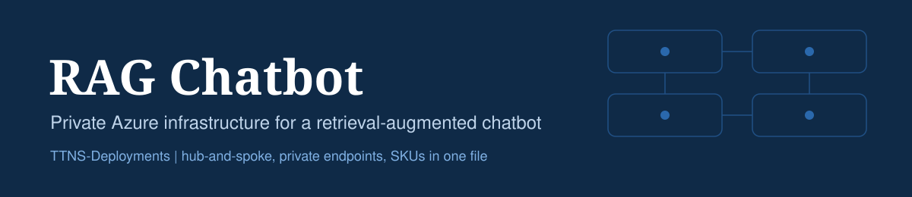

# RAG Chatbot on Azure

ARM templates and shell scripts that provision the Azure infrastructure for a customer-facing retrieval-augmented (RAG) chatbot: a web app that answers questions from your own documents using Azure OpenAI and Azure AI Search with hybrid retrieval. The network is hub-and-spoke, Application Gateway is the only public endpoint, and every backend service is reached through a private endpoint.

Every SKU, tier and capacity is set in one file, [`config/skus.env`](config/skus.env), so you can resize the deployment without touching the templates. Deployment is idempotent and runs with one command.

This repository provisions infrastructure only. The chatbot application code goes in [`app/`](app/). A simple front-end page that summarizes the deployment is in [`index.html`](index.html) and can be published with GitHub Pages.

## Summary Table of Deployed Resources

Resources are listed in deployment order, and template numbers match that order.

| # | Name | Description | Service | SKU inputs (`config/skus.env`) | Template |
| - | ---- | ----------- | ------- | ------------------------------ | -------- |
| 1 | Network | Hub and spoke VNets, NSGs, peering, private DNS | Virtual Network, Private DNS | none (address ranges are set in `scripts/common.sh`) | [`01-network.json`](templates/01-network.json) |
| 2 | Monitoring | Logs and application telemetry | Log Analytics, Application Insights | `LOG_ANALYTICS_SKU`, `LOG_RETENTION_DAYS`, `APPINSIGHTS_RETENTION_DAYS` | [`02-monitor.json`](templates/02-monitor.json) |
| 3 | Key Vault | Holds keys and connection strings | Key Vault | `KEYVAULT_SKU`, `KEYVAULT_SOFT_DELETE_DAYS` | [`03-keyvault.json`](templates/03-keyvault.json) |
| 4 | Storage | Source documents | Storage Account (blob) | `STORAGE_SKU`, `STORAGE_ACCESS_TIER` | [`04-storage.json`](templates/04-storage.json) |
| 5 | Session store | Chat session history | Cosmos DB for NoSQL | `COSMOS_CAPACITY_MODE`, `COSMOS_THROUGHPUT` | [`05-cosmosdb.json`](templates/05-cosmosdb.json) |
| 6 | Search | Hybrid retrieval with semantic ranking | Azure AI Search | `SEARCH_SKU`, `SEARCH_REPLICAS`, `SEARCH_PARTITIONS`, `SEARCH_SEMANTIC` | [`06-search.json`](templates/06-search.json) |
| 7 | Models | Chat and embedding deployments | Azure OpenAI | `OPENAI_ACCOUNT_SKU`, `CHAT_*`, `EMBEDDING_*` | [`07-openai.json`](templates/07-openai.json) |
| 8 | Web app | Chatbot orchestration | App Service (Linux) | `APP_PLAN_SKU`, `APP_RUNTIME` | [`08-appservice.json`](templates/08-appservice.json) |
| 9 | Public entry | Only internet-facing endpoint | Application Gateway v2 | `APPGW_SKU`, `APPGW_CAPACITY` | [`09-appgateway.json`](templates/09-appgateway.json) |
| 10 | Secrets | Writes keys to Key Vault | Key Vault secrets | none | [`10-secrets.json`](templates/10-secrets.json) |
| 11 | Access | Web app identity to each service | Azure RBAC, Cosmos DB roles | none | [`11-rbac.json`](templates/11-rbac.json) |

## Deployed Resources in More Detail

- **Network** (`templates/01-network.json`): A hub VNet with an Application Gateway subnet and a spoke VNet with an App Service integration subnet and a private endpoints subnet, peered both ways. NSGs apply deny-by-default inbound rules, with explicit allows only for the gateway's required traffic and for HTTPS to the private endpoints. Six private DNS zones (blob, search, openai, azurewebsites, vaultcore, documents) are linked to both VNets.
- **Monitoring** (`templates/02-monitor.json`): A Log Analytics workspace and a workspace-based Application Insights resource.
- **Key Vault** (`templates/03-keyvault.json`): Azure RBAC authorization, public network access disabled, and a private endpoint. Purge protection is off so you can tear it down while testing.
- **Storage Account** (`templates/04-storage.json`): StorageV2 with a `documents` blob container, anonymous access off, TLS 1.2 minimum, public network access disabled, and a blob private endpoint.
- **Cosmos DB** (`templates/05-cosmosdb.json`): NoSQL API with a `chatbot` database and a `sessions` container partitioned on `/sessionId`, session consistency, periodic backup, and a private endpoint. Provisioned or serverless is a SKU input.
- **Azure AI Search** (`templates/06-search.json`): Private endpoint, public access disabled, API key and Entra ID authentication both enabled, and the semantic ranker switched on so hybrid queries (keyword, vector, and semantic reranking) work.
- **Azure OpenAI** (`templates/07-openai.json`): One account with a chat deployment and an embedding deployment, public access disabled, and a private endpoint created in the VNet's region.
- **App Service** (`templates/08-appservice.json`): A Linux plan and web app with a system-assigned identity, regional VNet integration with all outbound traffic routed through the VNet, HTTPS only, FTP off, TLS 1.2 minimum, and a private endpoint.
- **Application Gateway** (`templates/09-appgateway.json`): A Standard v2 gateway with a static public IP and a DNS label, forwarding to the web app's private endpoint with a health probe. It listens on HTTP port 80 until you add a certificate (see "After deployment").
- **Key Vault secrets** (`templates/10-secrets.json`): Writes `OpenAIApiKey`, `SearchAdminKey`, `CosmosDbConnectionString` and `StorageConnectionString` through the Key Vault resource provider, so the vault can stay private.
- **Access** (`templates/11-rbac.json`): Gives the web app's identity Key Vault Secrets User, Storage Blob Data Contributor, Search Index Data Contributor, Search Service Contributor, Cognitive Services OpenAI User, and Cosmos DB Built-in Data Contributor.

### How it fits together

A customer's request reaches Application Gateway in the hub VNet, which forwards it across the peering to the App Service's private endpoint. The app embeds the question with the embedding model, runs a hybrid search in Azure AI Search, passes the retrieved passages to the chat model, and stores the session in Cosmos DB. Documents live in Blob Storage, and secrets live in Key Vault. The app reads secrets through Key Vault references, and its managed identity can reach each service directly. The app and every backend service reach each other only through private endpoints.


### Why Azure OpenAI has its own region setting

Model availability differs by region and changes often, and the chat model named in an older solution document may no longer be deployable. The Azure OpenAI account therefore has its own `OPENAI_LOCATION` (default `eastus2`), while everything else uses `LOCATION` (default `centralindia`). A private endpoint can connect to a resource in another region, so the private endpoint is still created in your spoke VNet. Cross-region calls add a small amount of latency, and prompts are processed in the account's region, so check this against your data-residency requirements.

`deploy.sh` checks that the models in `config/skus.env` are offered in `OPENAI_LOCATION` before it deploys anything.

## SKU Inputs

All sizing lives in [`config/skus.env`](config/skus.env). The defaults are a reasonable starting point; review them against your budget and expected traffic.

| Variable | Controls | Default |
| -------- | -------- | ------- |
| `APPGW_SKU`, `APPGW_CAPACITY` | Application Gateway tier and instance count | `Standard_v2`, `1` |
| `APP_PLAN_SKU`, `APP_RUNTIME` | App Service plan size and Linux runtime | `P1v3`, `PYTHON\|3.12` |
| `OPENAI_ACCOUNT_SKU` | Azure OpenAI account tier | `S0` |
| `CHAT_MODEL_NAME`, `CHAT_MODEL_VERSION` | Chat model | `gpt-4.1-mini`, `2025-04-14` |
| `CHAT_DEPLOYMENT_SKU`, `CHAT_CAPACITY_K_TPM` | Deployment type and quota (thousands of tokens per minute) | `Standard`, `30` |
| `EMBEDDING_MODEL_NAME`, `EMBEDDING_MODEL_VERSION` | Embedding model | `text-embedding-3-large`, `1` |
| `EMBEDDING_DEPLOYMENT_SKU`, `EMBEDDING_CAPACITY_K_TPM` | Deployment type and quota | `Standard`, `30` |
| `SEARCH_SKU`, `SEARCH_REPLICAS`, `SEARCH_PARTITIONS` | AI Search tier and scale | `standard`, `1`, `1` |
| `SEARCH_SEMANTIC` | Semantic ranker | `standard` |
| `COSMOS_CAPACITY_MODE`, `COSMOS_THROUGHPUT` | Cosmos DB mode and RU/s | `Provisioned`, `400` |
| `STORAGE_SKU`, `STORAGE_ACCESS_TIER` | Storage redundancy and access tier | `Standard_LRS`, `Hot` |
| `KEYVAULT_SKU`, `KEYVAULT_SOFT_DELETE_DAYS` | Key Vault tier and soft-delete retention | `standard`, `7` |
| `LOG_ANALYTICS_SKU`, `LOG_RETENTION_DAYS`, `APPINSIGHTS_RETENTION_DAYS` | Monitoring tier and retention | `PerGB2018`, `30`, `90` |

Notes on the defaults:

- **Chat model.** The default is `gpt-4.1-mini` because `gpt-35-turbo` is retired or retiring and may not be deployable for new deployments. If your solution document specifies a different model, change `CHAT_MODEL_NAME` and `CHAT_MODEL_VERSION`. List what your region offers with `az cognitiveservices model list --location eastus2 -o table`.
- **Embedding dimensions.** The vector fields in your AI Search index must match the embedding model: 3072 for `text-embedding-3-large`, 1536 for `text-embedding-3-small` and `text-embedding-ada-002`.
- **Minimum tiers.** Private endpoints need an App Service plan of B1 or above and an AI Search tier of `basic` or above. `deploy.sh` refuses Free and Shared plans.
- **Using another file.** Run `SKU_FILE=/path/to/other.env ./deploy.sh` to keep separate sizing for dev and production.

## Repository Layout

```
RAG_Chatbot/
├── README.md
├── index.html                  # simple front-end page (GitHub Pages)
├── deploy.sh                   # deploys everything, in order
├── deploy-openai.sh            # standalone: redeploy just the models
├── config/
│   └── skus.env                # every SKU, tier and capacity input
├── scripts/
│   └── common.sh               # shared settings and helpers
├── templates/                  # resource-group-scope ARM templates, in deployment order
│   ├── 01-network.json
│   ├── 02-monitor.json
│   ├── 03-keyvault.json
│   ├── 04-storage.json
│   ├── 05-cosmosdb.json
│   ├── 06-search.json
│   ├── 07-openai.json
│   ├── 08-appservice.json
│   ├── 09-appgateway.json
│   ├── 10-secrets.json
│   └── 11-rbac.json
├── app/                        # chatbot application code goes here
├── imgs/                       # banner and architecture diagram
├── LICENSE
├── CODE_OF_CONDUCT.md
├── SECURITY.md
├── SUPPORT.md
└── .gitignore
```

## Prerequisites

1. **An Azure subscription** where you can create resources and role assignments. Contributor plus User Access Administrator, or Owner, on the subscription or resource group. Step 11 creates role assignments, which Contributor alone cannot do.
2. **Azure OpenAI access and quota** for the chat and embedding models in `OPENAI_LOCATION`.
3. **Azure CLI.** Check with `az --version`. Install: <https://learn.microsoft.com/en-us/cli/azure/install-azure-cli>
4. **jq**, used to parse deployment outputs. Check with `jq --version`. Install with `sudo apt install jq` (Debian/Ubuntu), `brew install jq` (macOS), or see <https://jqlang.org/download/>
5. **Bash.** The scripts use `set -euo pipefail`. On Windows, run them through WSL or Git Bash rather than PowerShell or cmd.

## Step-by-Step: Deploying from Scratch

1. **Clone the repository**

   ```bash
   git clone https://github.com/TTNS-Deployments/RAG_Chatbot.git
   cd RAG_Chatbot
   ```

2. **Log in to Azure**

   ```bash
   az login
   az account set --subscription "<subscription-id-or-name>"
   ```

3. **Set your SKUs.** Open `config/skus.env` and adjust the values. Then review the settings block at the top of `scripts/common.sh`. Each can also be overridden with an environment variable:

   ```bash
   RESOURCE_GROUP="rg-chatbot-dev"
   LOCATION="centralindia"
   OPENAI_LOCATION="eastus2"
   NAME_PREFIX="chatbot"
   ENVIRONMENT="dev"
   APP_PUBLIC_ACCESS="Disabled"
   ```

   Resource names are generated from `NAME_PREFIX`, `ENVIRONMENT`, and a uniqueness suffix, so re-running with the same values updates existing resources instead of colliding with them.

4. **Run the script**

   ```bash
   chmod +x deploy.sh
   ./deploy.sh
   ```

5. **Review the plan and confirm.** The script prints every SKU it is about to deploy and asks for confirmation. It then checks that your chosen models exist in `OPENAI_LOCATION` before creating anything. Use `./deploy.sh --yes` to skip the prompts in automation; with `--yes`, a missing model stops the run.

6. **Read the summary at the end.** It lists the public URL, every resource name, and the secrets stored in Key Vault.

Application Gateway is usually the slowest step, and a full run typically takes 20 to 40 minutes.

## After Deployment

- **Add HTTPS.** The gateway listens on HTTP port 80 only. Before real users reach it, add a certificate and an HTTPS listener:

  ```bash
  az network application-gateway ssl-cert create -g rg-chatbot-dev --gateway-name agw-chatbot-dev \
    -n site-cert --cert-file site.pfx --cert-password "<pfx-password>"
  az network application-gateway frontend-port create -g rg-chatbot-dev --gateway-name agw-chatbot-dev \
    -n port-443 --port 443
  az network application-gateway http-listener create -g rg-chatbot-dev --gateway-name agw-chatbot-dev \
    -n listener-443 --frontend-port port-443 --frontend-ip public-frontend --ssl-cert site-cert
  az network application-gateway rule create -g rg-chatbot-dev --gateway-name agw-chatbot-dev \
    -n route-https --rule-type Basic --http-listener listener-443 --address-pool webapp-pool \
    --http-settings webapp-https --priority 110
  ```

  Then point your domain's DNS at the gateway's DNS name. Re-running `deploy.sh` redeploys the gateway template, which resets it to HTTP only, so repeat these commands afterwards.
- **Deploy your application code** to the App Service (`WEB_APP_NAME` in the summary). With `APP_PUBLIC_ACCESS="Disabled"` the web app and its deployment site are private, so deploy from a build agent or machine inside the VNet (for example a pipeline agent, jump box, or VPN client). For a quick proof of concept you can temporarily allow public access, deploy, and switch it back:

  ```bash
  az resource update -g rg-chatbot-dev -n <web-app-name> --resource-type Microsoft.Web/sites \
    --set properties.publicNetworkAccess=Enabled
  ```

- **Create the search index and load documents.** The index, its vector field (dimensions must match your embedding model), and the semantic configuration are not created by this repository. Upload source files to the `documents` container, then index them with your ingestion pipeline. Reaching the private Storage and Search endpoints from outside the VNet needs the same private access as above.
- **Check the Key Vault references.** Role assignments and references can take a few minutes to start working. If an app setting shows as unresolved, restart the web app.

## Redeploying a Single Piece

Every resource has its own template, and every deployment is named after its template, so you can redeploy one without touching the rest. To redeploy only the models after editing `config/skus.env`:

```bash
./deploy-openai.sh
```

Any other single template can be redeployed directly, but most need the outputs of earlier ones (subnet and DNS zone IDs), so prefer re-running `./deploy.sh`. ARM deployments are idempotent: re-running a template against an existing resource updates it in place.

## Tearing Everything Down

```bash
az group delete --name rg-chatbot-dev --yes --no-wait
```

Key Vault and Azure OpenAI accounts are soft-deleted, so re-creating them with the same name in the same resource group fails until they are purged:

```bash
az keyvault purge --name <key-vault-name>
az cognitiveservices account purge --name <openai-account-name> --resource-group rg-chatbot-dev --location eastus2
```

## Assumptions

- Resource group `rg-chatbot-dev` in `centralindia`, Azure OpenAI in `eastus2`, prefix `chatbot`, environment `dev`. All are overridable.
- A single region and a single environment. There is no multi-region failover.
- The gateway uses the Standard v2 SKU without a web application firewall, as in the original solution design. Consider WAF v2 before exposing the chatbot to the public internet.
- Not included: Azure Functions, Azure Backup, Microsoft Defender for Cloud, DDoS Protection, a VPN or Bastion host, and Microsoft Entra ID configuration for admin sign-in. Add them as separate templates if your design needs them.
- Application Insights uses its public ingestion endpoint. Add Azure Monitor Private Link Scope if telemetry must stay private too.
- The templates were compiled and checked with the Bicep CLI and the scripts were exercised against a mock Azure CLI, but they have not been run against a live subscription. Do a first run in a non-production subscription.

## Cost Note

Application Gateway, the App Service plan, and AI Search bill continuously regardless of traffic, and are usually most of the monthly cost. Azure OpenAI bills per token, Cosmos DB bills per provisioned RU/s, and the rest is low at this scale. Change the SKUs in `config/skus.env`, then review current pricing before deploying: <https://azure.microsoft.com/en-us/pricing/calculator/>

## Troubleshooting

- **`az: command not found` or `jq: command not found`**: install the missing tool. See Prerequisites.
- **`Run 'az login' first.`**: you are not authenticated. Run `az login` and retry.
- **`Missing values in config/skus.env`**: a variable was deleted or left empty. Restore it from the file in this repository.
- **A model is not found in the region**: `deploy.sh` stops before deploying. Pick a model and deployment type your region lists (`az cognitiveservices model list --location <region> -o table`) or change `OPENAI_LOCATION`.
- **Quota errors on Azure OpenAI, App Service, or Search**: some subscriptions have per-region quota limits. Check your quota in the Azure portal, lower the capacity in `config/skus.env`, or try another region.
- **`AuthorizationFailed` on role assignments (step 11)**: you need User Access Administrator or Owner.
- **A vault or account name already exists**: a soft-deleted Key Vault or Azure OpenAI account is blocking it. Purge it (see Tearing Everything Down).
- **A deployment fails partway through**: `deploy.sh` does not roll back earlier steps. Fix the reported error and re-run `./deploy.sh`; resources that already deployed update in place.
- **Gateway shows 502 or unhealthy backend**: check the backend health in the portal. The web app must be running and its private endpoint DNS must resolve from the hub VNet; the private DNS zones are linked to both VNets by step 1.

## Contributing and Support

See [SUPPORT.md](SUPPORT.md) for questions and bug reports, [SECURITY.md](SECURITY.md) for reporting vulnerabilities, and [CODE_OF_CONDUCT.md](CODE_OF_CONDUCT.md) for community expectations.

## License

Released under the [MIT License](LICENSE).
