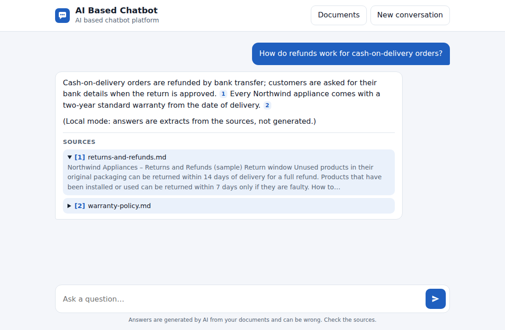
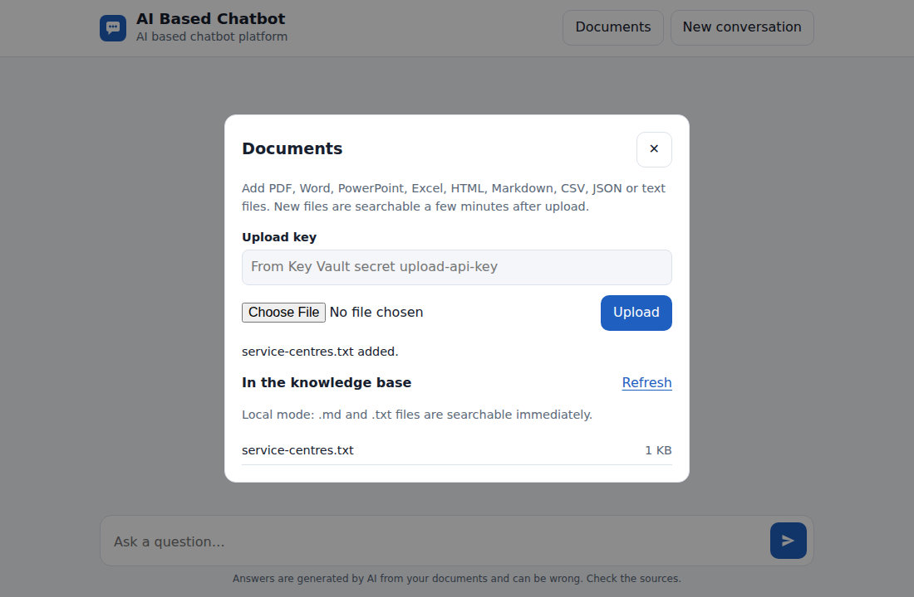

# AI Based Chatbot

**AI based chatbot platform**

AI Based Chatbot answers questions from your organisation's own documents. Users chat on a web page. Every answer is written by Azure OpenAI from passages that Azure AI Search found in your documents, and it lists the sources it used so users can check them.

The solution is a deployable template. You choose the tier (SKU) of every Azure service in one parameters file and deploy with one command or the **Deploy to Azure** button.

[](https://portal.azure.com/#create/Microsoft.Template/uri/https%3A%2F%2Fraw.githubusercontent.com%2FTTNS-Deployments%2Fchat-bot%2Fmain%2FDeployment%2FARM%2Fazuredeploy.json/createUIDefinitionUri/https%3A%2F%2Fraw.githubusercontent.com%2FTTNS-Deployments%2Fchat-bot%2Fmain%2FDeployment%2FARM%2FcreateUiDefinition.json)

> The button deploys the infrastructure and, by default, the application code straight from this repository's `main` branch. The scripted path (`Deployment/scripts/deploy.sh` or `deploy.ps1`) deploys both too, and also validates SKUs against your region first (see [Deployment options](#deployment-options)). The button only works while this repository is public, or if the template URLs point to a location the portal can read.

<br/>

## Overview

- **Grounded answers with citations.** Each question runs a hybrid (keyword + vector) search with semantic reranking. The best passages go to the chat model, which must answer only from them and cite them as `[1]`, `[2]`… The page shows the cited sources with a snippet.
- **Follow-up questions.** The conversation stays in the browser tab and recent turns are sent with each question, so "and for returns?" works.
- **Search one document.** Pick it under "Search in", or say "only in the warranty policy" / "specifically from the returns document". The filter is applied in the search query, the choice holds for follow-ups until you change it or say "search all documents", and the bot asks when the document is unclear. Unscoped answers say which document each fact comes from.
- **Personal information hidden by default.** Names, addresses, phone numbers, emails, ID/account numbers and customer counts are masked in answers, exports and logs, and shown only when you ask for that item ("show the customer address").
- **Download the chat.** "Download chat" (or typing "download chat history") saves the conversation as .txt, .json or .docx, with the same masking.
- **Your documents.** PDF, Word, PowerPoint, Excel, HTML, Markdown, CSV, JSON and text. Add them on the chat page (protected by an upload key) or with a script. Azure AI Search splits, embeds and indexes them automatically.
- **No keys.** The web app and the search service use managed identities; key-based access is switched off on Azure OpenAI, AI Search and Storage. The one secret, the upload key, lives in Key Vault. (The Free search tier has no managed identity, so in that mode the deployment puts the keys it needs in Key Vault.)
- **Sized by you.** Every SKU lives in a parameters file with `dev`, `standard` and `prod` presets, is validated before deployment, and appears as a dropdown in the portal wizard.

<br/>

## Current State of the Repository

### Before this build 

The repository held an infrastructure-only design for a *private* hub-and-spoke deployment. It had no application and no Deploy to Azure button.

| Files | What they contained | Status |
|---|---|---|
| `README.md` | Description of the infrastructure, SKU table, manual post-deployment steps | Documentation of a plan; it linked to `LICENSE`, `CODE_OF_CONDUCT.md`, `SECURITY.md` and `SUPPORT.md`, which did not exist |
| `templates/01-network.json` … `11-rbac.json` | 11 sequential ARM templates: hub/spoke VNets, private DNS, Application Gateway, Cosmos DB, AI Search, Azure OpenAI, App Service, Key Vault secrets, RBAC | Partial: compiled with Bicep, never deployed to a live subscription (per its own README) |
| `deploy.sh`, `deploy-openai.sh`, `scripts/common.sh` | Bash scripts deploying the 11 templates in order | Partial: exercised against a mock CLI only |
| `config/skus.env` | SKU inputs as shell variables | Working input for those scripts |
| `app/README.md` | "Place the chatbot application here" | Planned: no code |
| `index.html`, `imgs/banner.svg`, `imgs/architecture.svg` | GitHub Pages summary and diagrams of the private design | Static |


### What this build adds

The old private-network files were removed (they remain in git history), because the target architecture and the reference repository use one public-endpoint template secured with managed identities. In their place:

| Area | Added | Status |
|---|---|---|
| Application | FastAPI backend (`Code/backend`): chat with retrieval, prompt building, citations, history; document upload/list/delete; health; rate limiting; search index setup on startup. Single-page front end (`Code/frontend`). | Working locally (local mode); Azure mode unit-tested with mocked services |
| Tests | 91 unit tests: prompt building, citations, retrieval, AI Search requests, OpenAI error handling, API validation and errors, uploads, and consistency of template, parameter files, portal form, app settings and button URL | Passing |
| Infrastructure | Bicep (`Deployment/bicep`, one module per concern) compiled to `Deployment/ARM/azuredeploy.json`; portal wizard `createUiDefinition.json` | Builds and lints with no warnings; arm-ttk passes 48 of 49 checks (the other is a style rule on how `webAppUrl` is built); **not yet deployed to a live subscription** |
| SKUs | Presets `dev`, `standard`, `prod` in `Deployment/ARM/parameters/`; `validate_skus.py` with region/model/quota checks | Working (region checks need `az login`) |
| Deployment | `deploy.sh`, `deploy.ps1`, `ingest.sh`, `ingest.ps1`, `package.py`, `build_arm.sh`; Deploy to Azure button; GitHub Actions CI and Deploy | Scripts tested against a mock Azure CLI; shellcheck and PSScriptAnalyzer clean |
| Docs and repo | `Documents/` (architecture, deployment guide, configuration, local development), `Deployment/README.md`, licence and policy files, dev container, pre-commit hook | Done |


## Architecture


| # | Step | Azure service |
|---|------|---------------|
| 1 | The user asks a question on the chat page; the browser sends it with the recent conversation | App Service (FastAPI) |
| 2 | Hybrid keyword + vector search with semantic reranking | Azure AI Search |
| 3 | The search service vectorises the question with the embedding model | Azure OpenAI (embedding deployment) |
| 4 | The question and the numbered sources go to the chat model, which answers only from them | Azure OpenAI (chat deployment) |
| 5 | The answer and the cited sources are returned and shown | App Service |
| A | A key holder uploads a document (or runs `ingest.sh`); it is stored and the indexer is started | Blob Storage |
| B | The indexer reads new and changed files (also every 30 minutes) | Azure AI Search indexer (managed identity) |
| C | Files are split into chunks and embedded, one search document per chunk | AI Search skillset + Azure OpenAI |

Supporting services: **Key Vault** holds the upload key; **Application Insights** and **Log Analytics** collect telemetry and diagnostic logs. All service-to-service access uses **managed identities** with least-privilege roles.

| Component | Resource | SKU parameters |
|---|---|---|
| Web app | App Service plan (Linux) + web app, Python 3.12 | `appServicePlanSku`, `appServiceInstanceCount` |
| Language models | Azure OpenAI with `chat` and `embedding` deployments | `openAiLocation`, `chatModelName`, `chatModelVersion`, `chatDeploymentSku`, `chatCapacity`, `embeddingModelName`, `embeddingModelVersion`, `embeddingDeploymentSku`, `embeddingCapacity` |
| Retrieval | Azure AI Search: index, data source, skillset, indexer | `searchSku`, `searchReplicaCount`, `searchPartitionCount`, `semanticSearch` |
| Documents | Storage account, `documents` container | `storageSku` |
| Secrets | Key Vault (RBAC) | `keyVaultSku` |
| Monitoring | Log Analytics + Application Insights | `logAnalyticsRetentionDays`, `logAnalyticsDailyQuotaGb` |

More detail: [Architecture](Documents/architecture.md)

<br/>

## Screens

| Chat with sources | Documents |
|---|---|
|  |  |

Screenshots taken in local mode, where answers are extracts from the sample documents. Deployed, the answers are written by the chat model.

<br/>

## Quick start (local mode, no Azure needed)

Local mode replaces Azure AI Search with keyword scoring over `Data/sample_docs`, and Azure OpenAI with an extractive stand-in, so you can run the page and the API anywhere:

```bash
make setup     # creates .venv and installs everything
make run       # http://localhost:8000
make test
```

Details, API examples and running against a deployed environment: [Local development](Documents/local-development.md).

<br/>

## Prerequisites

| Requirement | Notes |
|---|---|
| Azure subscription | **Owner** on the target resource group, or Contributor + User Access Administrator. The template creates role assignments. |
| Azure OpenAI access and quota | Quota for the chat and embedding models, with the chosen deployment types, in `openAiLocation`. Check *Azure AI Foundry → Quotas*. The defaults need 30K TPM each (`dev`). |
| Resource providers | `Microsoft.Web`, `Microsoft.CognitiveServices`, `Microsoft.Search`, `Microsoft.Storage`, `Microsoft.KeyVault`, `Microsoft.OperationalInsights`, `Microsoft.Insights` registered (`az provider register -n <namespace>`). |
| Tools (scripted deployment) | Azure CLI 2.60+, Python 3.10+, and bash or PowerShell 7. The dev container in `.devcontainer/` has everything, including Bicep, shellcheck and PSScriptAnalyzer. |

<br/>

## Choosing SKUs

Every tier and size lives in a **SKU file** in [`Deployment/ARM/parameters/`](Deployment/ARM/parameters), not in the templates. There are three presets:

| Preset | For | Highlights |
|---|---|---|
| [`dev`](Deployment/ARM/parameters/dev.parameters.json) | Trials and development | App Service B1, AI Search basic with 1 replica, free semantic ranker, 30K TPM per model, LRS storage |
| [`standard`](Deployment/ARM/parameters/standard.parameters.json) | A small production workload | App Service P0v3, AI Search basic with 2 replicas (read SLA), standard semantic ranker, 50K TPM, ZRS storage |
| [`demo`](Deployment/ARM/parameters/demo.parameters.json) | An always-on, show-only demo with a few documents, deployed from Azure Cloud Shell | Cheapest everything: web app on an existing App Service plan, Free AI Search, `gpt-5-mini` 20K TPM (South India), `text-embedding-3-small` 10K TPM (East US), LRS storage, no diagnostic-log export, shared-password sign-in. See [Demo deployment](Documents/demo-deployment.md). |
| [`prod`](Deployment/ARM/parameters/prod.parameters.json) | Larger document sets and traffic | App Service P1v3 x2, AI Search S1 with 2 replicas, `text-embedding-3-large`, 150K/120K TPM, chat processed within the Data Zone (embeddings stay in the region), 90-day logs |

What each field controls:

| Field | Affects | Allowed values |
|---|---|---|
| `location` | Region of everything except Azure OpenAI | Any region with the services |
| `appServicePlanSku`, `appServiceInstanceCount` | Web app cost, capacity and SLA | `B1`-`B3`, `S1`-`S3`, `P0v3`-`P3v3`; 1-10 |
| `openAiLocation` | Where prompts and documents are processed; which models exist | Region offering both models |
| `openAiSku` | Azure OpenAI account tier | `S0` |
| `chatModelName`, `chatModelVersion` | Answer quality, speed and price | Any chat model offered in `openAiLocation` (default `gpt-5-mini` 2025-08-07) |
| `chatReasoningEffort` | Speed and cost of reasoning models such as `gpt-5-mini` | `minimal`, `low`, `medium`, `high`; `none` for non-reasoning models |
| `embeddingLocation` | Region of the embedding model; another region than the chat model creates a second Azure OpenAI resource | Empty (same as chat) or a region offering the model |
| `chatDeploymentSku`, `embeddingDeploymentSku` | Data processing location and default quota | `GlobalStandard`, `DataZoneStandard`, `Standard` |
| `chatCapacity`, `embeddingCapacity` | Throughput limit in thousands of tokens per minute; must fit your quota | 1-1000 |
| `embeddingModelName` | Retrieval quality, index size, embedding cost (changing it means rebuilding the index) | `text-embedding-3-small` (1536), `text-embedding-3-large` (3072) |
| `searchSku` | Index storage, limits and price | `free` (one per subscription, 50 MB, no semantic ranker), `basic`, `standard`, `standard2`, `standard3` |
| `searchReplicaCount` | Query throughput and SLA (2+ for read SLA) | basic 1-3; standard 1-12 |
| `searchPartitionCount` | Index size | basic 1-3; standard 1, 2, 3, 4, 6, 12 (replicas x partitions ≤ 36) |
| `semanticSearch` | Reranking quality and per-query cost | `disabled`, `free` (1,000 queries a month), `standard` |
| `storageSku` | Durability of the source documents | `Standard_LRS`, `_ZRS`, `_GRS`, `_RAGRS`, `_GZRS`, `_RAGZRS` |
| `keyVaultSku` | Key Vault tier | `standard`, `premium` |
| `logAnalyticsRetentionDays`, `logAnalyticsDailyQuotaGb` | Log cost and history | 30-730 days; GB per day or `-1` for no cap |
| `enableDiagnostics` | Export of App Service, AI Search and Azure OpenAI logs to Log Analytics | `true`, `false` |
| `existingAppServicePlanName` | Put the web app on an existing Linux plan in the same resource group and region (the plan is not changed) | Empty (create a plan) or a plan name |

**How to change SKUs:**

1. Edit a preset, or copy one to a new name (`cp dev.parameters.json uat.parameters.json` → deploy with `-e uat`).
2. Or override single values at deploy time, without editing files: `deploy.sh -e dev --set searchSku=standard --set chatCapacity=60`, or `deploy.ps1 -Environment dev -Set searchSku=standard,chatCapacity=60`.
3. Validate: `python3 Deployment/scripts/validate_skus.py -e dev [--set …] --check-region`. The deploy scripts always run this first. It rejects values the template does not allow, AI Search scale combinations Azure refuses, and (with `--check-region`, after `az login`) services, models or deployment types not offered in your regions. It also warns when Azure OpenAI quota looks too low. Example:

   ```text
   The SKU selection is not valid:
     - searchReplicaCount=5: the basic tier allows 1-3 replicas
     - chat model gpt-5-mini version 2025-08-07 with deployment type Standard is not offered in 'centralindia'.
       List what is: az cognitiveservices model list -l centralindia -o table
   ```

The button path offers the same choices as dropdowns and sliders in the portal wizard. The full reference, with per-preset values, is in [Deployment/README.md](Deployment/README.md).

<br/>

## Deployment options

### 1. Deploy to Azure button

Click the button at the top. The portal wizard asks for:

| Tab | Fields |
|---|---|
| Basics | Subscription, resource group, region, solution prefix (3-8 lowercase letters/digits), environment |
| Azure OpenAI | Azure OpenAI region; chat model, version, deployment type, capacity; embedding model, version, deployment type, capacity |
| Azure AI Search | Tier; replicas and partitions (limited to what the tier allows); semantic ranker |
| Hosting and data | App Service plan and instances; storage redundancy; Key Vault tier; log retention and daily cap |
| Application | Deploy the application code (default **Yes**: App Service pulls and builds this repository's `main` branch); repository URL and branch; document upload on/off |

It deploys: Log Analytics, Application Insights, a storage account with the `documents` container, Key Vault with a generated upload key, Azure OpenAI with two model deployments, AI Search, an App Service plan and web app, all role assignments, and (by default) the application code. Then follow [post-deployment steps](#post-deployment-steps-and-document-ingestion).

### 2. Script (bash)

```bash
az login
az account set --subscription "<subscription>"
Deployment/scripts/deploy.sh -g rg-chatbot-dev -e dev --seed
```

### 3. Script (PowerShell)

```powershell
az login
./Deployment/scripts/deploy.ps1 -ResourceGroup rg-chatbot-dev -Environment dev -Seed
```

Both scripts validate the SKUs, create the resource group, deploy the template, grant you data access for ingestion, deploy the code, wait until the app reports healthy, and with `--seed`/`-Seed` load the sample documents. Options: `--set`/`-Set`, `--param`/`-Param` (secrets such as `demoPassword` and `uploadApiKey`, not printed), `--code-via-arm` (bash; code deployment with management calls only), `--skip-infra`/`-SkipInfra` (code only), `--skip-code`/`-SkipCode`, `--skip-region-check`/`-SkipRegionCheck`, `-l`/`-Location`, `-s`/`-Subscription`. On the first deployment the scripts generate the upload key and print it once. Redeploying is safe and keeps the stored upload key and demo password.

### 4. Demo from Azure Cloud Shell

The `demo` preset deploys with management (ARM) calls only, because Cloud Shell cannot reach Microsoft Graph, the App Service deployment endpoints, or Storage and Key Vault with a sign-in token. One command does it:

```bash
cd ~ && (git clone https://github.com/TTNS-Deployments/chat-bot.git 2>/dev/null || true) && cd ~/chat-bot && git pull && Deployment/scripts/deploy.sh -e demo --param demoPassword='CHOOSE-A-PASSWORD'
```

See [Demo deployment](Documents/demo-deployment.md) for what it creates, what it costs, and how to remove it.

### 5. GitHub Actions

`.github/workflows/deploy.yml` deploys a chosen preset through OIDC. One-time setup is in the [Deployment guide](Documents/deployment-guide.md#2d-deploy-with-github-actions).

<br/>

## Post-deployment steps and document ingestion

1. **Check health:** open `https://<web app>/healthz`. Expect `"status": "ok"` and `"searchSetup": "ready"`. The web app creates the search index, data source, skillset and indexer on startup. While it shows `"pending"`, wait a few minutes. It retries for about 5 minutes and then shows `"failed"`; usually the role assignments were not active yet, so wait a few minutes and restart the web app.
2. **Get the upload key:**
   ```bash
   az keyvault secret show --vault-name <key-vault> -n upload-api-key --query value -o tsv
   ```
   The scripts give the deploying identity access. After a portal deployment, first give yourself *Key Vault Secrets User* on the vault.
3. **Add documents**, one of:
   - **Chat page:** **Documents** → paste the upload key → choose a file → **Upload**. The dialog shows the indexing status and any per-file errors.
   - **Script** (bulk, folders): `Deployment/scripts/ingest.sh -g <rg> ./my-docs ./faq.pdf` or `./Deployment/scripts/ingest.ps1 -ResourceGroup <rg> -Path ./my-docs`.
   - **Anything that writes to Blob Storage** (Storage Explorer, AzCopy, a pipeline) into the `documents` container; the indexer picks files up within 30 minutes.
4. **Wait a few minutes**, then ask a question that your documents answer.
5. Delete the sample documents if you loaded them (`--seed`): remove them from the `documents` container (portal or Storage Explorer), or call `DELETE /api/documents/<name>` with the `X-Upload-Key` header. The chat page has no delete button. The indexer removes deleted files from the index on its next run.

Full steps and troubleshooting: [Deployment guide](Documents/deployment-guide.md).

<br/>

## Using the chatbot

- Type a question and press **Enter** (Shift+Enter for a new line). The page shows *Searching the documents…* while it works.
- Answers cite sources as numbered markers. Click a marker, or a source under the answer, to see the passage it came from.
- Ask follow-ups naturally ("and for washing machines?"). The last six exchanges are taken into account.
- If the documents do not cover a question, the chatbot says so instead of guessing.
- **New conversation** clears the history (it is kept only in this browser tab).
- On errors (service busy, connection lost) the message stays in the box and **Try again** resends it.
- The API is documented at `/api/docs`.

<br/>

## Cost notes, security notes, clean-up

### Cost notes

- **Billed continuously:** the App Service plan (per instance) and Azure AI Search (per search unit = replicas x partitions). These are most of the fixed monthly cost. `dev` uses the smallest sensible sizes.
- **Billed per use:** Azure OpenAI tokens (questions and indexing), the semantic ranker beyond the free 1,000 queries a month on the `standard` plan, storage per GB, and Log Analytics ingestion (capped by `logAnalyticsDailyQuotaGb`).
- `text-embedding-3-large` costs several times more than `-small` per token and doubles index size.
- Check current prices for your region before deploying: <https://azure.microsoft.com/pricing/calculator/>

### Security notes

- **No keys anywhere:** managed identities with least-privilege roles; key auth disabled on Azure OpenAI, AI Search and Storage. The upload key is the only secret and lives in Key Vault.
- **Uploads are protected** by the upload key, file-type and size checks, because uploaded text becomes grounding data for every user.
- **The chat page has no sign-in by default.** Anyone with the URL can ask questions (rate limited per IP). For a demo, set `authMode=password`: one shared password, stored in Key Vault, with a lockout after 5 wrong tries (no Entra ID app registration needed). For internal use, turn on App Service Authentication with Microsoft Entra ID: *Web app → Authentication → Add identity provider → Microsoft*, then require authentication. The [Deployment guide](Documents/deployment-guide.md#3-after-deployment) has the CLI command.
- Services keep public endpoints protected by Entra ID; private endpoints and WAF are not part of this template.
- Details: [SECURITY.md](SECURITY.md).

### Clean-up

```bash
az group delete --name rg-chatbot-dev --yes --no-wait
```

Key Vault and Azure OpenAI are soft-deleted. To reuse the same names (same resource group and prefix), purge them:

```bash
az keyvault purge --name <key-vault-name>
az cognitiveservices account purge --name <openai-account-name> --resource-group rg-chatbot-dev --location <openai-location>
```

<br/>

## Troubleshooting

| Symptom | Fix |
|---|---|
| `The SKU selection is not valid` | Read the listed values; change the preset or use `--set`. For "not offered in region", pick from `az cognitiveservices model list -l <region> -o table` or change `openAiLocation`. |
| `InsufficientQuota` during deployment | Lower `chatCapacity`/`embeddingCapacity`, use another deployment type or region, or request quota. |
| `AuthorizationFailed` on role assignments | You need Owner, or Contributor + User Access Administrator, on the resource group. |
| Name already exists / soft-deleted vault or account | Purge it (see [Clean-up](#clean-up)). |
| `/healthz` shows `"searchSetup": "failed"` | Role assignments were probably not active yet. Wait a few minutes and restart the web app. `searchSetupDetail` gives the reason. |
| Upload says the key is not available yet | The Key Vault reference has not resolved; restart the web app after a few minutes. |
| "The service could not answer right now" | Application Insights → Failures shows the cause (deployment name, permission, retired model). |
| "Too many questions in a short time" | Per-IP rate limit; raise `RATE_LIMIT_PER_MINUTE` if users share one IP. |
| Answers never find a document | Documents dialog → indexing status/errors. Scanned PDFs without a text layer need OCR (not included). |
| Portal deployment fails on the Git code deployment (`sourcecontrols`) | The infrastructure is in place. Deploy the code with `deploy.sh -g <rg> -e dev --skip-infra`. |

More: [Deployment guide → Troubleshooting](Documents/deployment-guide.md#troubleshooting).

<br/>

## Repository layout

| Path | Contents |
|---|---|
| [`Code/backend`](Code/backend) | `chatbot` Python package: FastAPI app, retrieval, prompt building and citations, Azure OpenAI and AI Search clients, document store, CLI; unit tests |
| [`Code/frontend`](Code/frontend) | The chat page (HTML, CSS, JavaScript; no build step) |
| [`Deployment/bicep`](Deployment/bicep) | Infrastructure source: `main.bicep` and one module per concern |
| [`Deployment/ARM`](Deployment/ARM) | Compiled `azuredeploy.json`, SKU presets (`parameters/`), portal form for the Deploy button |
| [`Deployment/environments`](Deployment/environments) | Per-environment script settings, for example `demo.env` (resource group, code deployment method) |
| [`Deployment/scripts`](Deployment/scripts) | `deploy.sh`/`.ps1`, `ingest.sh`/`.ps1`, `validate_skus.py`, `build_arm.sh`, `package.py` |
| [`Data/sample_docs`](Data/sample_docs) | Fictional sample documents for local mode and smoke tests |
| [`Documents`](Documents) | Architecture, deployment guide, configuration, local development |
| [`imgs`](imgs) | Architecture diagram (SVG source) and screenshots |
| [`.github/workflows`](.github/workflows) | CI (tests, template freshness, linters) and Deploy (manual, per preset) |
| [`.devcontainer`](.devcontainer), [`.githooks`](.githooks) | Codespace/dev container with az, Bicep, PowerShell; pre-commit check for `azuredeploy.json` |

<br/>

## Status and roadmap

| Item | Status |
|---|---|
| Chat with grounded answers, citations, history; document upload and script ingestion; Bicep/ARM, button, scripts, presets | Implemented; tested locally and with mocked Azure services |
| First deployment to a live subscription (template what-if, model availability in the default regions, Git code deployment from the button) | To do: needs a subscription with Azure OpenAI quota |
| Optional user sign-in built into the template, private endpoints, OCR for scanned PDFs | Planned / on request |

<br/>

## Contributing, support and licence

- Run `make setup hooks` once. Before committing: `make test lint check-arm`. Commit Bicep changes together with the rebuilt `Deployment/ARM/azuredeploy.json` (the pre-commit hook and CI enforce this).
- Support: [SUPPORT.md](SUPPORT.md). Security issues: [SECURITY.md](SECURITY.md). Conduct: [CODE_OF_CONDUCT.md](CODE_OF_CONDUCT.md).
- Licence: proprietary, see [LICENSE](LICENSE).
